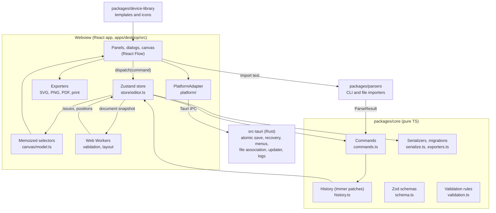

# Architecture

**Every change to a diagram is a command applied by the pure-TypeScript core. The UI only renders
derived state, and the Rust side only touches the operating system.** This keeps the domain
testable in Node, makes undo and redo simple, and lets the whole UI run in a plain browser for fast
end-to-end tests. See [ADR 0003](../adr/0003-command-patch-architecture.md).



## Layers

| Layer          | Path                        | Rules                                                                                                                                                                  |
| -------------- | --------------------------- | ---------------------------------------------------------------------------------------------------------------------------------------------------------------------- |
| Core           | `packages/core`             | Zod schemas and types, commands, history, selectors, IP utilities, validation rules, serializers and migrations. No React, DOM or Tauri imports, no side effects.      |
| Parsers        | `packages/parsers`          | Pure functions `text → ParseResult { entities, unparsedLines, warnings }`. Input is untrusted: size limits, linear-time patterns, fuzz tests, secrets stripped.        |
| Device library | `packages/device-library`   | Template JSON, original SVG icons and a typed index. Vendor templates need a public datasheet `sourceUrl`.                                                             |
| Brand          | `packages/brand`            | Logo masters, lockups, bundled fonts. See [brand.md](../brand.md).                                                                                                     |
| App            | `apps/desktop/src`          | React UI. Never mutates the model directly; only dispatches commands.                                                                                                  |
| Platform       | `apps/desktop/src/platform` | The only place that may import `@tauri-apps/*`. `tauri.ts` for the app, `browser.ts` (in memory and IndexedDB) for Playwright and the browser build.                   |
| Shell          | `apps/desktop/src-tauri`    | Rust: atomic save with `.bak`, autosave and crash recovery, native menus, single instance and "Open with", logging, panic hook, updater. Least-privilege capabilities. |

A repository test (`scripts/repo-rules.test.mjs`) enforces the import rules: no DOM globals or UI
dependencies in core and parsers, and no Tauri imports outside `platform/`.

## Data flow

1. A user action (drag, menu, shortcut, inspector edit) calls a function in `lib/actions.ts` or
   dispatches a command through the store's `execute`.
2. The core runs the command with Immer's `produceWithPatches`, which returns the new frozen
   document plus forward and inverse patches.
3. `History` stores the patches. Commands with the same `coalesceKey` in a row merge into one undo
   step, so a whole drag gesture undoes at once.
4. The Zustand store publishes the new document. Unchanged entities keep their object identity
   (structural sharing), so memoized selectors and React components skip them.
5. `canvas/model.ts` derives the page model (device views, link views with routing, labels and
   styles) for the active page and view (L1, L2 or L3), and the canvas renders it.
6. The validation worker receives the latest snapshot, runs the rules and posts issues back,
   tagged with a revision so stale results are ignored. Layout (ELK, d3-force) runs off the main
   thread too, and its result is applied as one command.

## Commands

A command is a plain object:

```ts
interface Command {
  label: string; // "Edit link" — shown as "Undo Edit link"
  coalesceKey?: string; // merge consecutive commands with this key into one undo step
  run: (draft: Draft<NetworkDocument>) => void;
}
```

Commands are built by factory functions in `packages/core/src/commands.ts`
(`addDevice`, `connect`, `updateLinks`, `moveNodes`, …). Importers build a reviewed plan with
`buildImportPlan` and apply it as one command with `applyImportPlan` (`packages/parsers/src/merge.ts`),
so an import is a single undo step. A command mutates the Immer draft and may throw to refuse an
invalid change; the error reaches the caller and the document is left untouched.

## Tabs

Each open diagram is a tab with its own document, history, page, selection and validation results.
The store keeps the inactive tabs in a stash and swaps them in on switch. Revisions are unique
across tabs, so a validation result for a background tab is never applied to the active one.

## Performance

The canvas renders only visible nodes and edges, reuses node and edge objects that did not change,
and draws all edge labels through one shared portal. Large-diagram budgets (NFR-PERF-01..07) are
measured by the benchmark suite in [`bench/`](../../bench) with generated 100 to 5,000-device
networks. Run `pnpm bench`.

## Security

- Strict CSP: no remote scripts, no `eval`, no inline scripts, no remote content (NFR-SEC-02).
- Tauri capabilities grant only the commands the app uses; file access is limited to paths the
  user picked and the app-data folder (NFR-SEC-01).
- Imported SVG is sanitized with DOMPurify; embedded assets are shown only as images.
- Config text is parsed, never executed, and secrets are dropped before they reach the model.
- The only network call is the update check, which you can turn off (NFR-PRIV-01).
