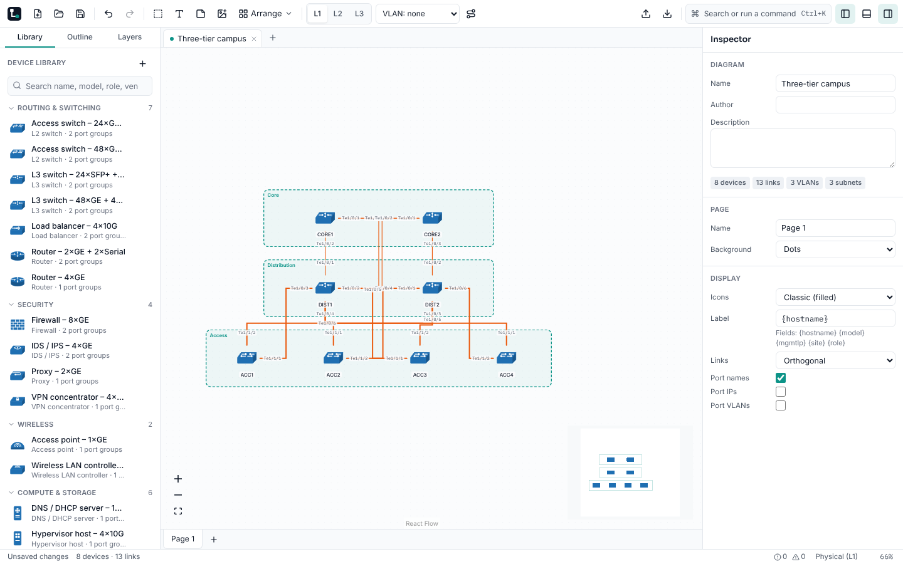

# M1 — Core model and canvas (`v0.1.0`)

**Status:** acceptance criteria met on commit `fca7252` (version 0.1.0), CI run [38081402516](https://github.com/gavenrobertson/LineWise/actions/runs/38081402516), all jobs green. Tag `v0.1.0` is created on that commit; the owner pushes it (docs/HUMAN-TODO.md).

## Acceptance criteria

| Criterion (spec section 13)     | Result | Evidence                                                                                                                          |
| ------------------------------- | ------ | --------------------------------------------------------------------------------------------------------------------------------- |
| E2E journey 1 passes            | Met    | `e2e/01-build-save-reopen.spec.ts` in Chromium (Windows, Linux) and WebKit (macOS, Linux)                                         |
| Undo/redo property test passes  | Met    | `packages/core/test/commands.test.ts` "property: any command sequence, fully undone, restores the original document" (fast-check) |
| Save → reopen is byte-identical | Met    | `packages/core/test/serialize.test.ts` "round-trips byte-identically", journey 1, and the documented example file's golden test   |

## Requirements

- **Done:** FR-APP-02, FR-CAN-01..09, FR-LNK-01..06, FR-INS-01..04, FR-NET-01..03, FR-ICO-01..03,
  FR-TPL-01, FR-TPL-02, FR-TPL-05, FR-FMT-01..07.
- **Partial:** FR-APP-09 (association and "Open with" done; the `.lwise` document icon comes with
  BRD-03 in M6), NFR-PERF-07 (generator and benchmark gates done; the 20% regression gate needs a
  baseline recorded on the CI runner, M5).

## Tests added in this audit

- E2E `09-canvas.spec.ts`: pan by wheel, Space+drag and middle button; zoom limits; fit and zoom to
  selection; grid snap and guides; minimap; every selection mode; nudge; shape resize and rotation;
  arrange; copy/paste; drop on a link; drawing, filtering, restyling and bending a link.
- E2E `11-files.spec.ts`: autosave on blur, the invalid-file dialog, newer files read-only, paste
  across diagrams, grid-size preference.
- E2E `10-tabs.spec.ts` and `test/tabs.test.ts`: diagram tabs with per-tab history.
- Unit: orthogonal routing (with a fast-check property), label spreading, link styles by medium,
  parallel links and bundles, drop-on-device hit test.

## Benchmarks (sandbox, 4-core Xeon, Chromium)

| Metric                                      | Result    | Target                |
| ------------------------------------------- | --------- | --------------------- |
| Cold start to welcome screen                | 547 ms    | ≤ 2,000 ms            |
| Open 500 devices / ~800 links               | 540 ms    | ≤ 2,000 ms            |
| Open 2,000 devices / ~3,000 links           | 1,829 ms  | ≤ 5,000 ms            |
| Pan, 500 devices                            | 55 fps    | ≥ 54 fps              |
| Pan, 2,000 devices                          | 57 fps    | ≥ 30 fps              |
| Drag frame time p95, 500 devices            | 16.8 ms   | ≤ 20.9 ms             |
| Property edit to canvas update, 500 devices | **73 ms** | ≤ 50 ms (not met; M5) |
| Hierarchical layout, 500 devices            | 0.9 s     | ≤ 3 s                 |
| JS heap, 500 devices                        | 80 MB     | ≤ 250 MB              |

## Decisions

- Diagram tabs in one window on both OSes (FR-APP-02).
- Zoom to fit never zooms past 100%.
- A pasted device keeps its hostname when it is free in the target diagram.

## Problems found and fixed

- Hierarchical and orthogonal auto-layout failed in production builds ("o is not a constructor").
- Dropping a link on a device's body did nothing; only the handle worked.
- Bend points were hidden under the selected link and could not be dragged.
- A blank page zoomed to 400% when the first device was placed.

## Known issues

- Property-edit latency with 500 devices is 73 ms against the 50 ms target (NFR-PERF-04); M5.
- `.lwise` document icon (BRD-03); M6.

## New HUMAN-TODO items

None.
