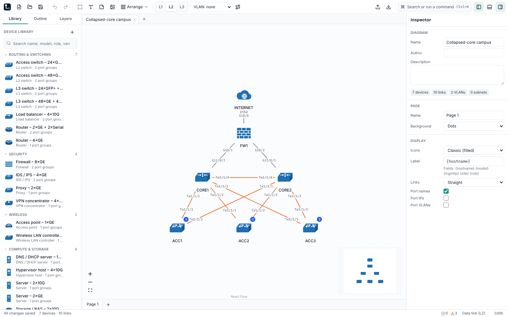

# M2 — Network features (`v0.2.0`)

**Status:** acceptance criteria met; FR-TPL-03 (verified vendor templates) is blocked, see below.
CI run: _filled in when the tag is placed_.

## Acceptance criteria

| Criterion (spec section 13)                                 | Result | Evidence                                                                                                                                                                                                    |
| ----------------------------------------------------------- | ------ | ----------------------------------------------------------------------------------------------------------------------------------------------------------------------------------------------------------- |
| E2E journey 2 passes                                        | Met    | `e2e/02-views-and-vlan.spec.ts` (three-tier campus, L1 → L2 → L3, VLAN 10 highlight; the document is unchanged by view switches)                                                                            |
| IP math property tests pass                                 | Met    | `packages/core/test/ip.test.ts` "IP math properties" (fast-check: address round-trips, containment, mask ↔ prefix, splits tile the block)                                                                   |
| A 50-device campus can be drawn fully by keyboard and mouse | Met    | `e2e/13-campus.spec.ts`: 2 cores, 4 distribution, 12 access switches and 32 workstations placed from the library with the keyboard, 53 links drawn through the connect dialog, then laid out with the mouse |

## Requirements

- **Done:** FR-NET-04..10, FR-NET-30..33, FR-CAN-10..13, FR-TPL-04.
- **Partial:** FR-KEY-02 (placing, nudging, linking, renaming and every command through the
  palette work from the keyboard; the full audit of canvas actions is in M5).
- **Blocked:** FR-TPL-03. Vendor templates may only ship once their port layouts are checked
  against public datasheets, and this environment's network policy denies every vendor site
  (cisco.com, juniper.net, arista.com, fortinet.com, paloaltonetworks.com, ui.com, meraki). No
  vendor templates were added; only the generic set ships. See HUMAN-TODO.

## Changes in this audit

- VLAN manager: add ranges (`100-110,200`) in one undo step; each VLAN lists the ports carrying it.
- Zones: moving a zone carries nested zones and their devices.
- Keyboard: focus returns to the source device after linking; Alt+Arrow moves from the focused
  device; the connect dialog ranks an exact hostname first.
- Core: loopbacks, SVIs and sub-interfaces can never be cabled; tunnels take virtual links only.
- E2E `12-network.spec.ts`: point-to-point addressing and IPAM, hover card, template editor with
  JSON export and import, annotations and embedded images, nested zones, off-page connectors,
  layers.

## Decisions

- No vendor templates from second-hand sources: unverifiable port data is not shipped, even marked
  unverified.

## Known issues

- FR-TPL-03 blocked (above).

## New HUMAN-TODO items

- Allow the vendor datasheet hosts in the environment's network settings, or add vendor templates
  by hand following CONTRIBUTING.md.
