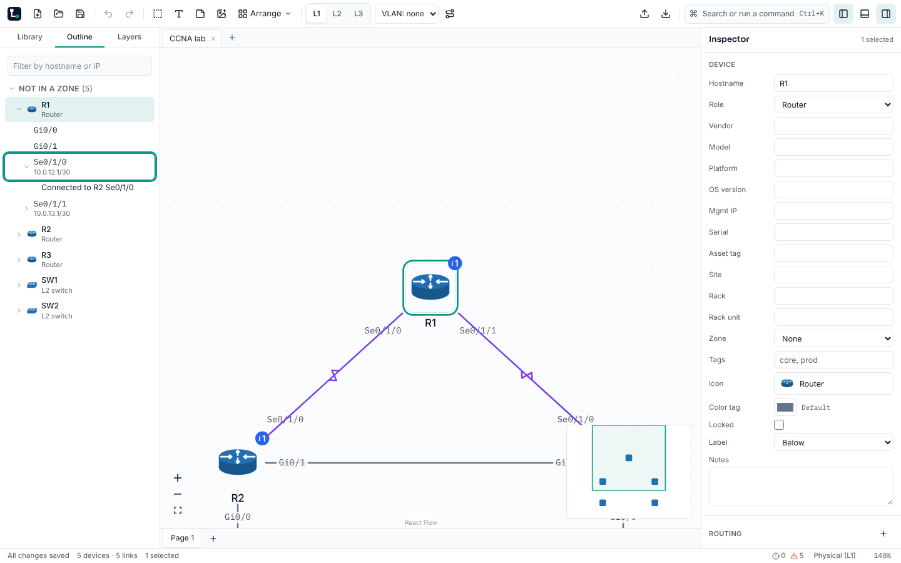
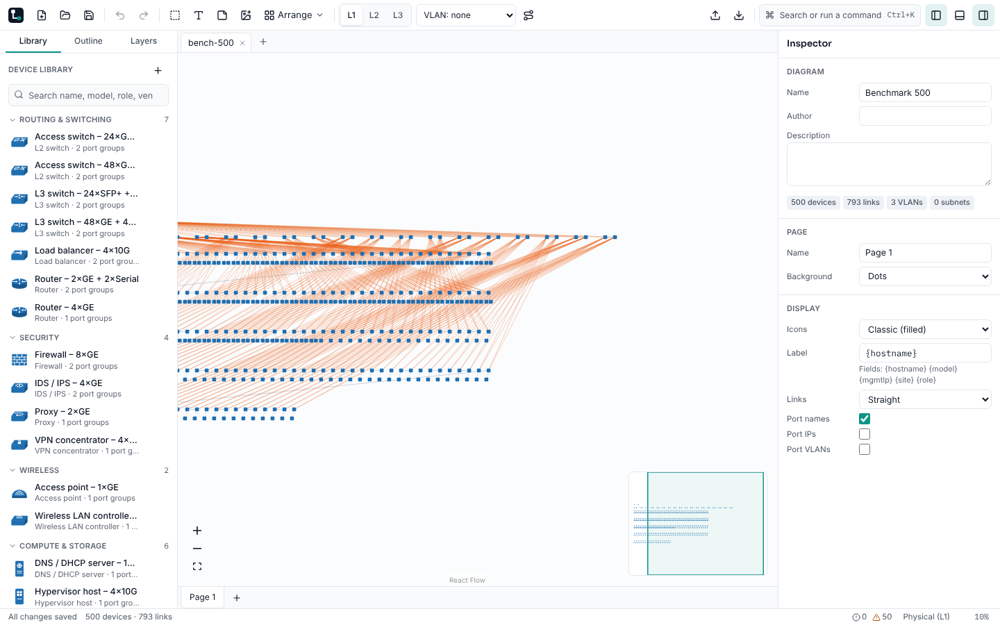
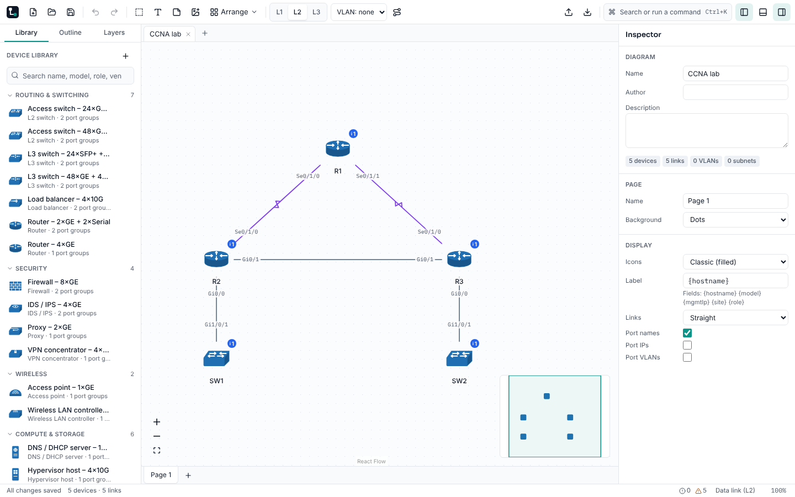
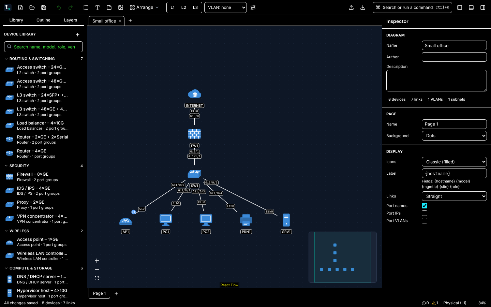

# M5 — Export, polish, accessibility, performance (`v0.9.0-beta`)

**Status:** acceptance criteria met. Benchmarks: nightly run [38104419268](https://github.com/gavenrobertson/LineWise/actions/runs/38104419268) on GitHub's `ubuntu-latest` runner, all NFR-PERF targets met in all three runs. The CI run that verifies the release commit is recorded in docs/HUMAN-TODO.md with the tag. The owner pushes the tag.

## Acceptance criteria

| Criterion (spec section 13)               | Result | Evidence                                                                                                                                                                                                                                                                                                                                                 |
| ----------------------------------------- | ------ | -------------------------------------------------------------------------------------------------------------------------------------------------------------------------------------------------------------------------------------------------------------------------------------------------------------------------------------------------------- |
| E2E journeys 6–8 pass                     | Met    | `e2e/06-exports.spec.ts` (PNG, SVG, PDF, CSV and draw.io are valid files), `e2e/07-keyboard-only.spec.ts` (build, link and rename without a mouse), `e2e/08-crash-recovery.spec.ts` (restore after a crash), in Chromium and WebKit in CI                                                                                                                |
| Zero axe violations                       | Met    | `e2e/14-a11y.spec.ts`: axe-core (WCAG 2.1 AA, including contrast) on the welcome screen, the main window in each view, the problems panel, every sidebar tab, every dialog and the palette, in light and dark themes, plus increased contrast; component tests run axe on 13 dialogs and the panels                                                      |
| All NFR-PERF targets met in CI benchmarks | Met    | Medians of 3 runs: cold start 537 ms (≤ 2,000), open 500 devices 425 ms (≤ 2,000), 2,000 devices 1,374 ms (≤ 5,000), pan 59.8 fps with 500 (≥ 54) and 59.0 with 2,000 (≥ 30), **drag p95 16.7 ms per frame** (≤ 16.7 + 25% timer slack; 16.7 in each run), edit to canvas 19 ms (≤ 50), auto-layout of 500 nodes 800 ms (≤ 3,000), JS heap 65 MB (≤ 250) |

The benchmark now gates on the median of three runs and, against `bench/baseline.json` recorded on the same runner type, a 20% regression budget (NFR-PERF-07).

## Requirements

- **Done in M5:** FR-EXP-01..08, FR-EXP-10; FR-APP-03..08; FR-KEY-01, FR-KEY-02; FR-CAN-15; FR-ICO-04..08; NFR-A11Y-01..05; NFR-I18N-01, NFR-I18N-02; NFR-PERF-01..05, NFR-PERF-07; NFR-REL-01..03; NFR-PRIV-01, NFR-PRIV-02; NFR-SEC-03, NFR-SEC-04, NFR-SEC-07, NFR-SEC-08; DOC-05.
- **Deferred:** FR-EXP-09 (Visio, MAY, post-1.0 per the spec).
- **Partial:** NFR-PERF-06 — the JS heap is measured here; native memory and the installer size (< 25 MB) are checked on release builds in M6.

## Screenshots

The topology outline as a tree, with a link peer reached from R1 (NFR-A11Y-02):

500 devices at the lowest zoom: plain shapes and the model-drawn minimap (NFR-PERF-04):

The L2 view with severity glyphs on badges and the color-blind-safe VLAN palette (NFR-A11Y-03):

Windows high contrast (forced colors) in the dark theme (NFR-A11Y-04):

## Problems found and fixed

- **Drag performance.** Dragging one device with 500 on screen cost about 100 ms per frame at the start of M5. Causes, in order of cost:
  - Props passed to React Flow changed on every render, so each one re-ran every node and edge selector.
  - The editor store woke every subscriber on each pointer move.
  - 2,000 connection handles, each with its own store subscription.
  - Two node subscriptions per link.
  - React Flow's minimap, which kept one subscription per node.
  - Drawing every icon at sizes too small to read.

  Each is fixed (decisions log 2026-10-10/11). Edit-to-canvas time went from 104 to 19 ms.

- **The benchmark measured the wrong thing.** It dragged a device at the edge of the view, so React Flow auto-panned the whole canvas. It also counted the press, which selects the device, as a drag frame.
- **Links to off-page connectors were never drawn** (FR-CAN-12): the pill had no handle.
- **Severity was shown by color alone, and the VLAN palette put green next to red** (NFR-A11Y-03).
- **The outline was a flat list** (NFR-A11Y-02). **Bend points, zone sizes and panning needed a mouse** (FR-KEY-02).
- **Zips:** the icon-pack zip check trusted the size declared in the archive header (NFR-SEC-04).
- **Icon packs:** pack icons were always embedded; references, a missing-pack fallback and the embed option were missing (FR-ICO-05/06).
- **Starters:** devices were not assigned to the zones drawn around them.
- **Small fixes:** the Arrange button had no tooltip, and the recent-files list had no accessible name.
- **CI:** the nightly Rust audit failed for lack of a permission although no advisory matched. The Windows parser timing test used a wall-clock limit.

## Tests added

- E2E:
  - `16-export-options` (every export option and print)
  - `17-app-shell` (layout, themes, welcome and recent files, starters, preferences, palette, help)
  - `18-a11y-keyboard` (Tab order, outline tree, severity glyphs, keyboard-only zone, bend and pan)
  - `19-privacy` (no request leaves the app)
  - `20-icons` (status marks, pack references and embedding, missing pack)
  - `21-find`
  - Forced colors, reduced motion, increased contrast and interface size in `14-a11y`
- Unit: zip limits including a header that understates the size, crash screen and diagnostics, outline tree, pack references, the benchmark gate, the VLAN palette's contrast, no credential fields in the schema.
- Rust: panic hook, OS text scale.

## Known issues

- Drag frames are at the 16.7 ms frame budget on GitHub's 4-vCPU runner, which has no GPU, so there is little headroom. The nightly gate's 20% regression budget catches any slide.
- The minimap moves a dragged device when it is dropped, not during the drag.

## New HUMAN-TODO items

- Push tag `v0.9.0-beta` (table in docs/HUMAN-TODO.md).
