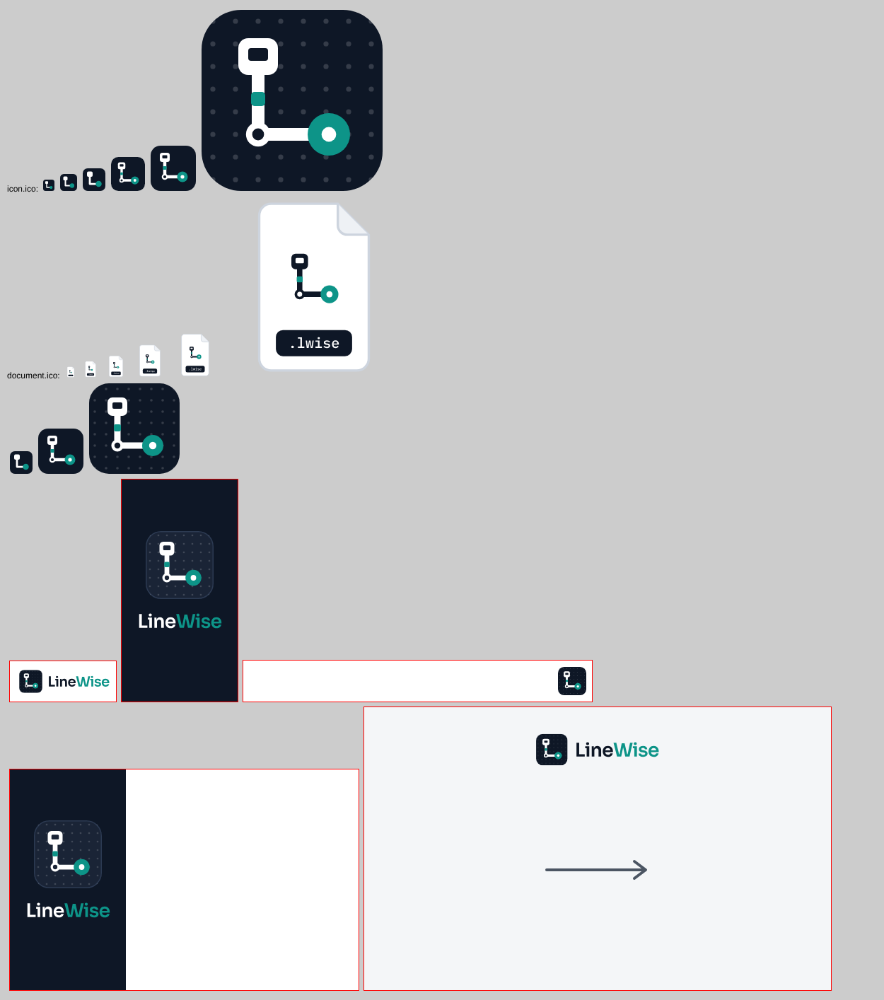
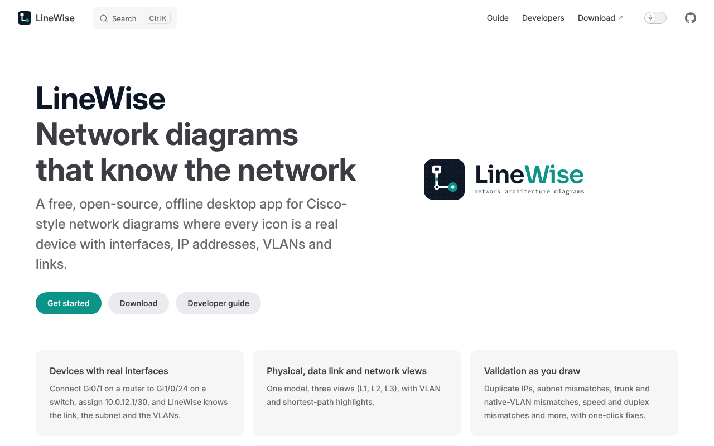
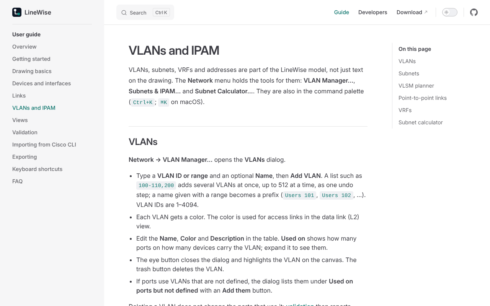

# M6 — Release engineering and v1.0

**Status:** everything that can be built and verified from the repository is done and green in CI;
docs/HUMAN-TODO.md records the 1.0.0 release commit and the CI run that verified it. The acceptance
criteria that need the owner's accounts and machines are open: signing keys and certificates,
pushing the tags, and the manual release checklist on the four target machines. `v1.0.0` is tagged
after those pass.

## Acceptance criteria

| Criterion (spec section 13)                                | Result               | Evidence                                                                                                                                                                                                                                                                                      |
| ---------------------------------------------------------- | -------------------- | --------------------------------------------------------------------------------------------------------------------------------------------------------------------------------------------------------------------------------------------------------------------------------------------- |
| A v0.9 install auto-updates to v1.0 on both OSes           | Waiting on the owner | The update flow is built and tested (`apps/desktop/test/updates.test.tsx`: launch check at most once a day, manual check, stable and beta feeds, Later, save before install, a failed signature check installs nothing). It needs the updater key pair and the published v0.9.0-beta release. |
| Gatekeeper accepts the macOS build                         | Waiting on the owner | `release.yml` signs and notarizes when the Apple secrets exist (`scripts/release-config.test.mjs`); without them the build is ad-hoc signed and the release notes say so.                                                                                                                     |
| Every MUST in `TRACEABILITY.md` is done with a linked test | 170 of 172           | `node scripts/traceability.mjs --require-must` lists the two open rows: FR-TPL-03 (vendor datasheets are blocked by this environment's network policy) and REL-21 (branch protection is a repository setting; the ruleset is ready to import).                                                |
| Release checklist completed on all four target machines    | Waiting on the owner | `docs/release-checklist.md`                                                                                                                                                                                                                                                                   |

## Requirements

- **Done in M6:** BRD-01..05; FR-APP-09 (document icon); REL-01..04, REL-10..12; NFR-SEC-06;
  NFR-PERF-06; DOC-01, DOC-02; OSS-05.
- **Ready, needs the owner:** REL-21 (`.github/rulesets/protect-main.json`).
- **Blocked:** FR-TPL-03 (vendor templates checked against datasheets).

## What was built

- **Icons and installer images from the brand masters.** `packages/brand/scripts/build-icons.mjs`
  renders each master at the size it is shown, runs `tauri icon` for the platform set and the macOS
  `.icns` (824 px body on a 1024 px canvas), then redraws every PNG and `.ico` entry from the master
  the size rules pick. It also writes the `.lwise` document icon and the NSIS, WiX and DMG images. A
  manifest of hashes makes the repo test fail when a master changes without a rebuild.
- **The `.lwise` document icon on both OSes.** Tauri's file associations cannot set one, so an NSIS
  hook, a WiX fragment and `Info.plist` do. CI installs both Windows installers and reads the
  registry, and checks the macOS bundle's `Info.plist` and resources.
- **Release gates:** installers over 25 MB fail the release; the native smoke test measures the idle
  app's whole process tree (web view helpers included) on Windows and Linux. Windows uses 165 MB idle (limit 250 MB); Linux, a best-effort platform, uses 425 MB under xvfb with software rendering and is reported only. macOS is checked by hand (release checklist).
- **Documentation site:** VitePress from `docs/`, published to GitHub Pages by `docs.yml`, with the
  user guide split into the eleven topics of DOC-01, the developer guide, the file format, the brand
  guide, the ADRs and the release checklist. Links to repository files outside the site go to
  GitHub. Help → Documentation opens the site.
- **Community:** a DCO sign-off check for contributor pull requests (OSS-05) and an importable
  ruleset for `main` (REL-21).

## Screenshots

App icons at every size (16–256 px; the small master at 32 px and below, no grid below 96 px), the
`.lwise` document icon, and the NSIS, WiX and DMG images:

The documentation site: the home page, and a user-guide page with the topic sidebar:

## Problems found and fixed

- **WebKit accessibility:** device and zone nodes carried `aria-label` without a role. axe reported
  it in WebKit, and in every browser once low zoom hides the label text; the axe suite now also
  runs zoomed out.
- **WebKit forced colors:** WebKit matches the media query but does not force colors and has no
  `forced-color-adjust`; the test compares links with `CanvasText` and waits for the style.
- **Rust formatting** failed CI on the 0.9.0-beta release commit.
- **Old app icons** were scaled down from one image, so the 16 and 32 px entries were the full mark,
  blurred.

## Tests added

- `scripts/brand.test.mjs` (masters verbatim, text as paths, generated outputs current, icon sizes,
  document-icon registration, installer images, theme colors and contrast).
- `scripts/release-pipeline.test.mjs`, `scripts/installer-size.test.mjs`, `scripts/dco.test.mjs`,
  `scripts/branch-rules.test.mjs`, `scripts/docs-site.test.mjs`.
- `apps/desktop/test/updates.test.tsx`.
- CI: document icon registered (Windows NSIS and MSI, macOS); idle memory in the native smoke test.

## Known issues

- The macOS app is checked by CI (bundle, `Info.plist`) but not driven end to end: there is no
  WebDriver for WKWebView. The release checklist covers it.
- Linux packages register `.lwise` files but do not ship a MIME-type icon (the spec asks for macOS and
  Windows).
