# UI/UX polish (2026-10-12)

This pass follows the [audit](ui-ux-audit.md) and covers FR-UX-01..13 (`TRACEABILITY.md`, "UX polish").
The aim is an app that feels calm and precise: the diagram comes first, motion explains what
happened, link labels are easy to read, and help appears where a question comes up. Design
decisions are in `docs/decisions-log.md` (2026-10-12).

[Screen recording, 19 s](img/ux-polish-tour.webm): tooltips, the L1/L2/L3 glide, device and link
hover cards, the Arrange menu, a help popover, the command palette, Preferences and the Problems
panel.

## Before and after

Three-tier campus, data link (L2) view, at the 66% that zoom to fit picks:

| Before                                                             | After                                                            |
| ------------------------------------------------------------------ | ---------------------------------------------------------------- |
| 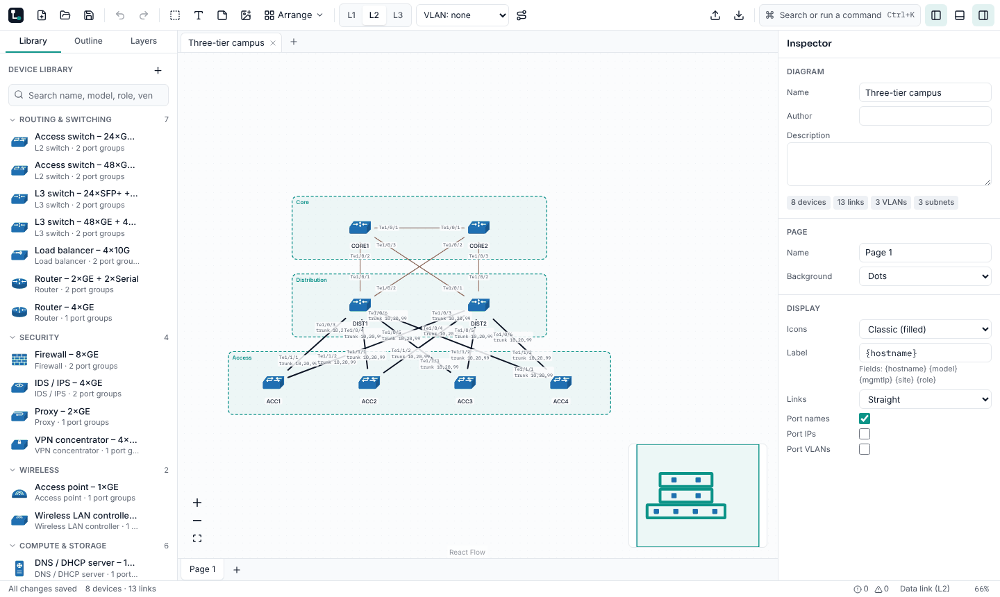       |        |
| 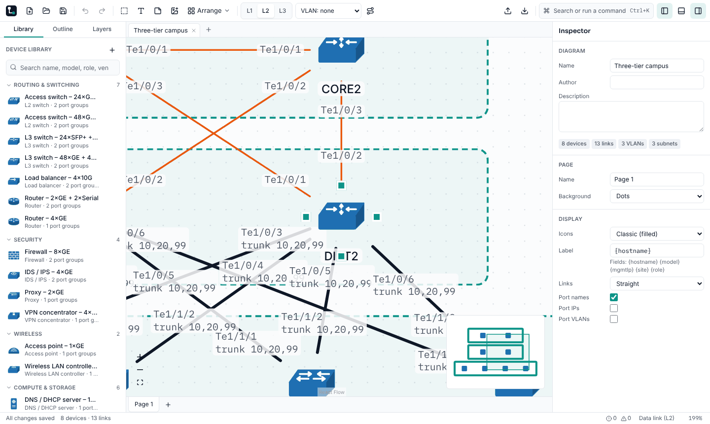     | 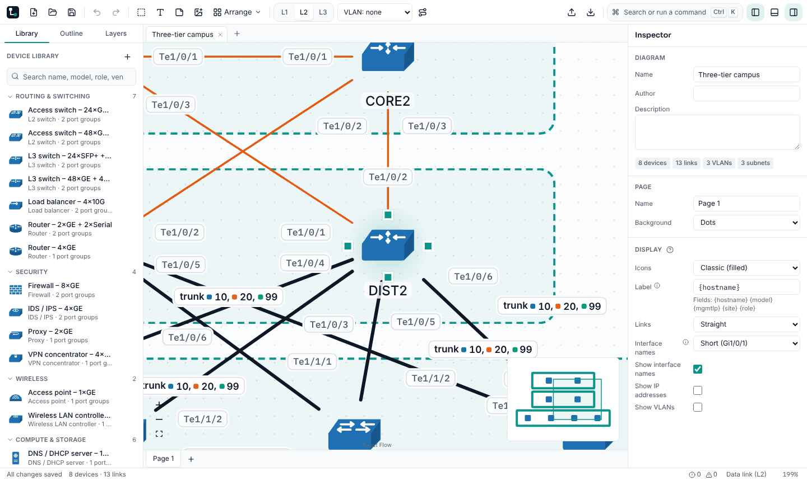     |
| 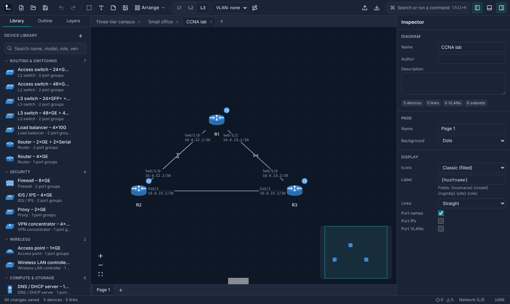    | 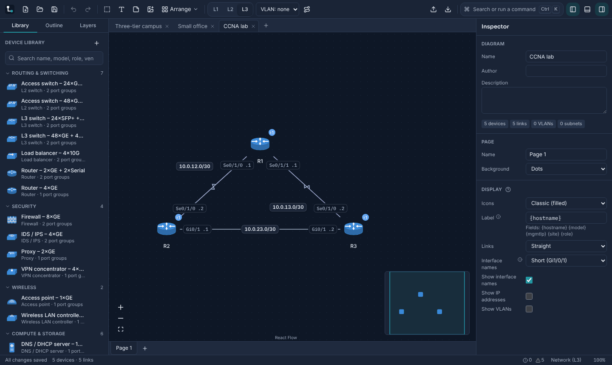    |
| 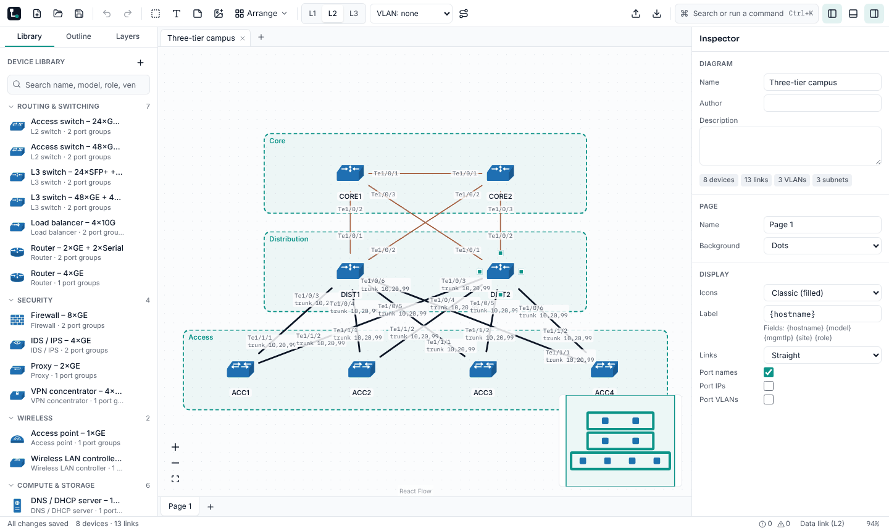 | 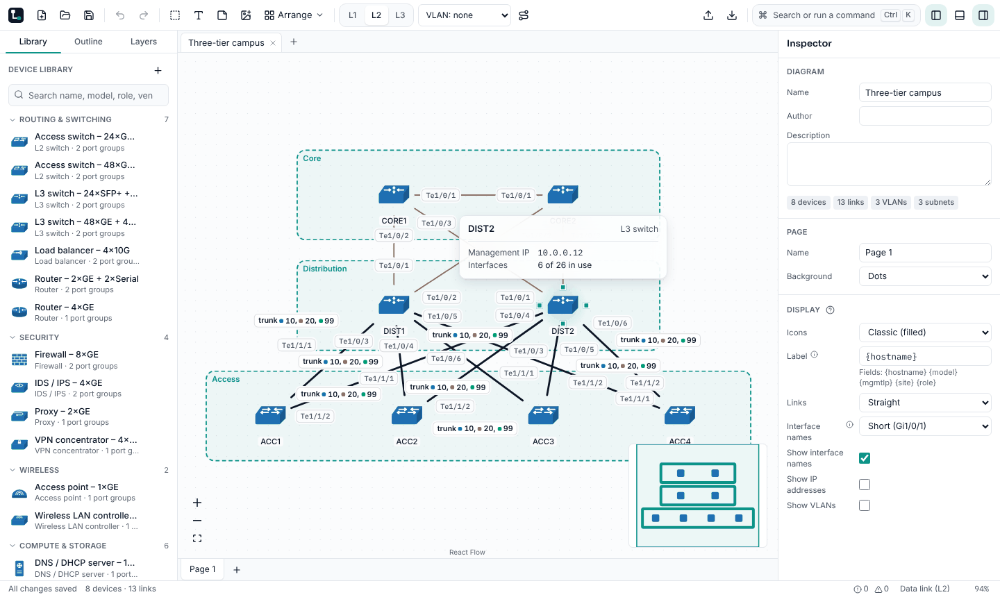 |
| 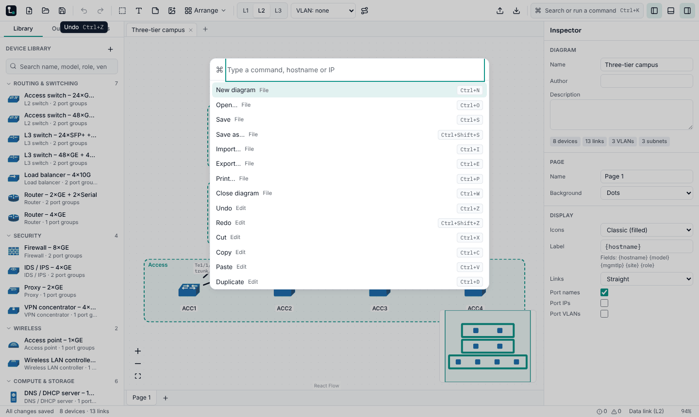           | 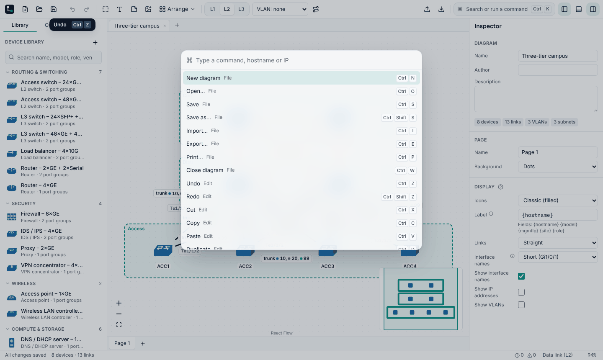           |

The link hover card, the Problems panel's "Why?", and the first-run tour:

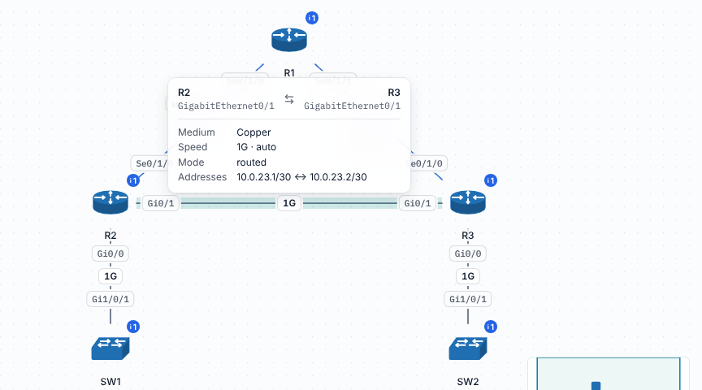

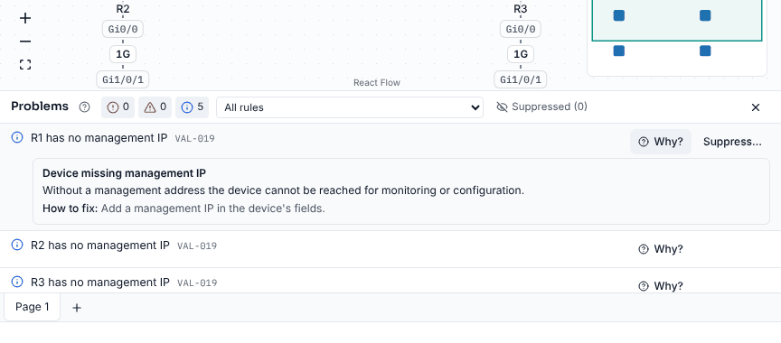

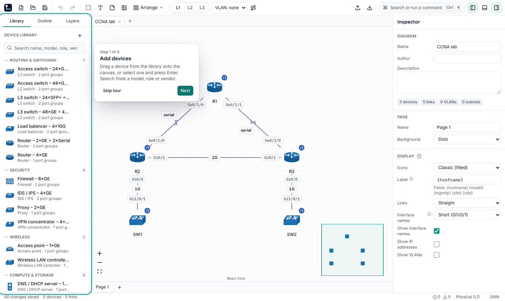

## What changed

- **Foundations (FR-UX-01).** Tokens for motion (80/140/220/320 ms; standard, emphasized and exit
  curves), three elevation levels (with a hairline highlight in dark mode), a translucent material
  for menus, popovers, the palette and toasts (opaque under increased contrast, reduced
  transparency and forced colors), one radius scale and a keyboard-only focus ring.
- **Motion (FR-UX-02, FR-UX-03).**
  - Controls: buttons lift on hover and press down. Menus, popovers and tooltips grow from their
    trigger. Dialogs rise over a dimmed canvas. Panels slide in, and their first sections follow.
    The L1/L2/L3 thumb and the side-panel tabs glide. Toasts spring up, and their countdown pauses
    on hover.
  - Canvas: a teal halo behind the hovered device, handles that pop in, a selection spring that
    also settles a drop, a glow on the hovered link, and eased zoom to fit.
  - Only transform and opacity animate, and everything is instant under reduced motion.
- **Link labels (FR-UX-04..06).**
  - Labels are 11 px pills with a hairline border and a canvas halo. They hold a readable size
    below 75% zoom and stop growing above 150%.
  - Each label is placed along its link, or beside it, where it overlaps nothing. The middle label
    sits on the longest straight segment.
  - Facts both ends share are written once, in the middle: the VLAN list with color chips in L2,
    the subnet in L3 (with `.1` and `.2` at the ends), and the speed and medium in L1.
  - Interface names can be short or long. Exports draw the same pills in the same places.
- **Hover cards (FR-UX-07, FR-UX-09).** One canvas card for devices and links, also opened by
  keyboard focus; the link card has one-click fixes. Interfaces, subnets and library templates get
  cards too. Links now have accessible names ("Link R1 Serial0/1/0 to R2 Serial0/1/0").
- **Tooltips (FR-UX-08).** Every browser `title` tooltip is replaced by one tooltip, with the
  shortcut as key caps. It opens after 500 ms, then at once while you move between controls, and
  on keyboard focus.
- **Help (FR-UX-10, FR-UX-11).**
  - A "?" popover on the inspector sections, the Problems panel and IPAM says what each one is,
    why it matters, gives an example and links to the guide.
  - An ⓘ explains each networking field.
  - Every validation rule says why it matters and how to fix it.
- **Tips, tour and empty states (FR-UX-12, FR-UX-13).**
  - At most one tip per session, with "Don't show again".
  - A four-step, non-modal tour on first run, which Help → Take the Tour shows again.
  - Empty panels show a line drawing and one action.
  - A voice and glossary section in `docs/brand.md`.

## Measurements

**Link labels**, measured in the browser at the zoom that zoom to fit picks. Each pair is labels
overlapping another label / labels overlapping a device icon or hostname:

| Starter, view                 | Zoom | Before     | Smallest label | After      | Smallest label |
| ----------------------------- | ---- | ---------- | -------------- | ---------- | -------------- |
| Three-tier campus L1          | 66%  | 0 / 0      | 6.6 px         | 1 / 0      | 8.2 px         |
| Three-tier campus L2          | 66%  | 8 / 6      | 6.6 px         | 2 / 0      | 8.2 px         |
| Three-tier campus L3          | 66%  | 0 / 0      | 6.6 px         | 1 / 0      | 8.2 px         |
| Small office L3               | 84%  | 1 / 0      | 8.4 px         | 0 / 0      | 9.3 px         |
| CCNA lab L3                   | 100% | 0 / 2      | 10 px          | 0 / 0      | 11 px          |
| Collapsed-core campus L1–L3   | 100% | 1 / 0 each | 10 px          | 0 / 1 each | 11 px          |
| Spine-leaf data center L1, L2 | 64%  | 0 / 0      | 6.4 px         | 1 / 0      | 8.2 px         |
| Spine-leaf data center L3     | 64%  | 4 / 7      | 6.4 px         | 2 / 0      | 8.2 px         |
| Hub-and-spoke WAN L3          | 90%  | 0 / 2      | 9 px           | 0 / 0      | 9.9 px         |
| DMVPN L3                      | 90%  | 1 / 3      | 9 px           | 0 / 0      | 9.9 px         |
| All 21 views                  |      | 17 / 20    |                | 8 / 3      |                |

Views not listed had no overlaps before or after.

- **At 100% zoom no two labels overlap** in any starter diagram or view; `test/ux.test.tsx` checks
  this on the model. The 8 overlaps above appear only below 75% zoom, where labels are drawn
  larger than the placement assumed so they stay readable.
- **The remaining device overlap** is in the collapsed-core campus: its internet-to-firewall link
  is 56 px long and the internet hostname sits on the line itself.
- **There are more labels than before**: L1 now names speed and medium in the middle of each link.

**Performance (NFR-PERF-01..07).** `pnpm bench`, 3 runs (medians) on this cloud container
(linux-4cpu):

| Metric                | Before (1 run) | After (median of 3) | Target    |
| --------------------- | -------------- | ------------------- | --------- |
| Cold start            | 793 ms         | 628 ms              | ≤ 2 s     |
| Open 500 devices      | 636 ms         | 507 ms              | ≤ 2 s     |
| Pan, 500 devices      | 58.2 fps       | 58.0 fps            | ≥ 54 fps  |
| Drag p95, 500 devices | 33.4 ms        | 33.4 ms             | see below |
| Edit to canvas        | 27.7 ms        | 29.5 ms             | ≤ 50 ms   |
| Auto-layout, 500      | 1,054 ms       | 952 ms              | ≤ 3 s     |
| Heap, 500             | 81 MB          | 72 MB               | ≤ 250 MB  |
| Open 2,000 devices    | 2,383 ms       | 2,005 ms            | ≤ 5 s     |
| Pan, 2,000 devices    | 58.8 fps       | 57.6 fps            | ≥ 30 fps  |

- **Edit, measured side by side:** comparing the previous build and this one alternately on the
  same host gave edits of 26–31 ms against 28–34 ms, inside the nightly gate's 20% budget.
- **Drag p95:** it jumps between one and two frames (16.8 or 33.4 ms) on this host for both
  builds, so it is not a regression. GitHub's runner measures it in the nightly.
- **Keeping edits fast:**
  - Unchanged links keep their wording, ends, accessible names and label places between edits,
    so an edit places only the labels it changed.
  - Interface rows are memoized.
  - The device halo and the link glow exist only on the element under the pointer.

## Checks

- Lint, typecheck and all unit tests pass (desktop 140, core 131, parsers 114, device library 15,
  bench 7). The repo script tests pass (92), as do the i18n check (960 strings) and the
  traceability check.
- End to end: all 69 tests pass in Chromium, including `e2e/22-ux.spec.ts`. It checks:
  - labels at 11 px or larger;
  - link cards on hover and on keyboard focus;
  - tooltips on focus with their key caps;
  - no motion under reduced motion;
  - the tour.

  The accessibility specs (axe in light, dark, increased contrast and forced colors) pass. CI
  runs WebKit as well.

- A component test fails if any DOM element in the app uses a `title` attribute.

## Follow-up: cursors, exits and dark by default (FR-UX-14..16)

| Dark, the new default                             | After the toolbar switch                                 |
| ------------------------------------------------- | -------------------------------------------------------- |
| 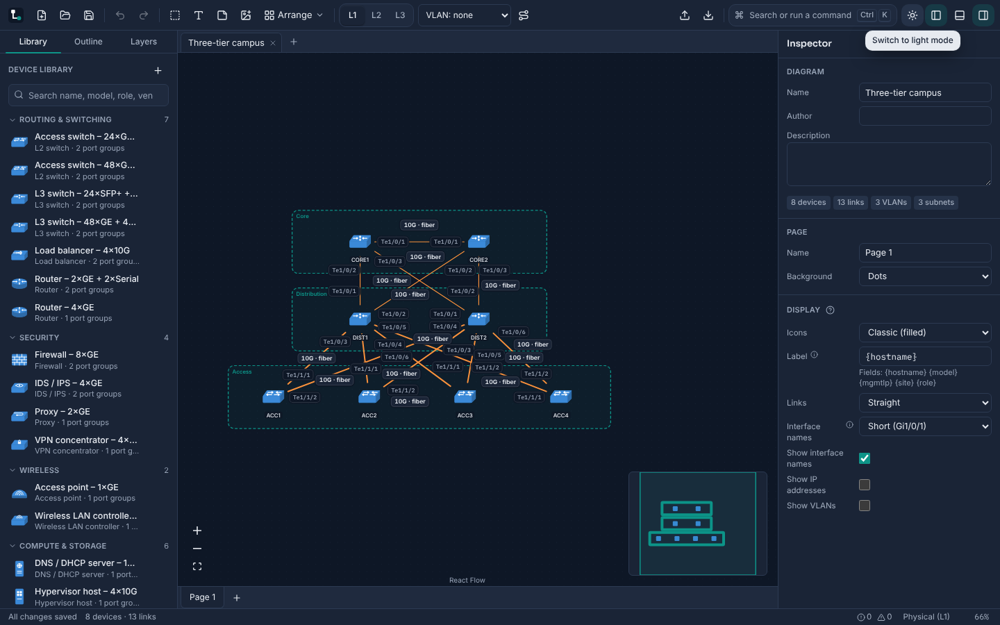 | 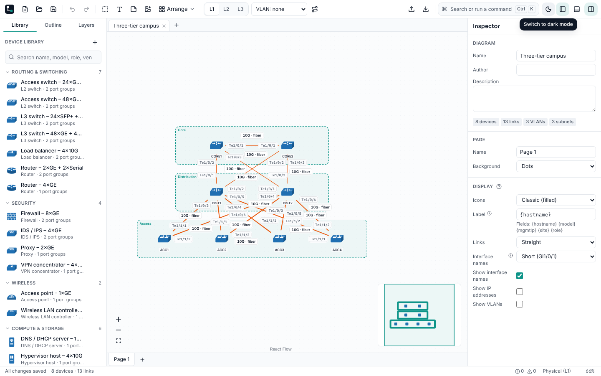 |

- **Pointer cursor (FR-UX-14)** on every control, tab, option, menu and tree item, and on the
  canvas on devices, links, connection handles and the minimap. A dragged device shows the closed
  hand, disabled controls show not-allowed and text fields keep the I-beam.
- **Eased exits (FR-UX-15).** Whatever eases in now eases out, in 140 ms: dialogs and the palette,
  menus, popovers and tooltips, the side panels, the find bar, toasts, the hover card and the tour.
  Hover tints fade both ways. On the canvas, the halo, handles and link glow fade out on the one
  element the pointer left, and are skipped while the view pans. A closing dialog lets go of the
  page at once, so a shortcut or click during the fade still lands.
- **Dark by default (FR-UX-16)** from the first frame, with a sun / moon button at the right of the
  toolbar (and View → Toggle Dark Mode) that cross-fades to the other theme. Preferences still
  offers System.
- **Performance.** On this host, alternating main and this branch three times each gave the same
  edit, drag and pan figures within run-to-run noise. Light and dark differ by about 1 fps when
  panning 500 devices, in both directions across runs.

## Known limits

- Below 75% zoom labels are held at a readable size, so in dense diagrams some can touch.
- "Learn more" opens the user guide online. Everything else is bundled.
